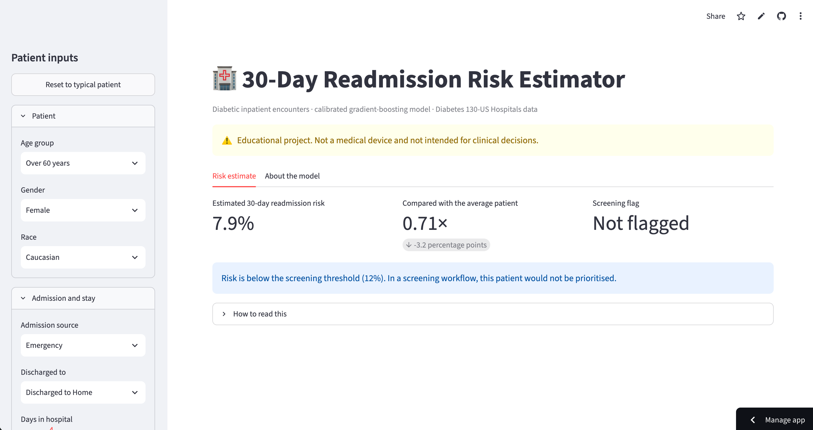

# Patient Readmission Risk Prediction

Predicting 30-day hospital readmission for diabetic patients, with a calibrated risk score shown in a Streamlit app.

Live demo: [patient-readmission-prediction-wachirapat.streamlit.app](https://patient-readmission-prediction-wachirapat.streamlit.app)



> Educational project. Not a medical device and not intended for clinical use.

## Problem

About 11% of diabetic patient encounters in this dataset are readmitted within 30 days. If likely readmissions can be flagged at discharge, hospitals can prioritise follow-up care. The model outputs a probability rather than just a yes/no label, so the score can be read as a risk.

## Data

- [Diabetes 130-US Hospitals (1999-2008)](https://www.openml.org/d/43874), OpenML version: about 101.8K encounters.
- Target: readmitted within 30 days (positive rate about 11%). The other encodings of the target (`readmitted`, `readmit_binary`) are dropped as leakage.
- Source: Strack et al. (2014), "Impact of HbA1c Measurement on Hospital Readmission Rates", BioMed Research International.

## Approach

1. Split first: stratified 80/20 train/test, then another 80/20 split inside train for a fit set and a validation set.
2. Clean hidden missing values (`?`, `Unknown`, ...), encode binary flags, and treat "not tested" lab results as their own category.
3. Build features inside a scikit-learn `Pipeline` (`features.py`) so anything learned from data (clipping cap, scaler, encoders) comes from training data only. The features are clipped length of stay, log medications, a stay × medications interaction, total procedures, care intensity, and the three prior-visit flags kept separate.
4. Compare models with 5-fold CV on the training set, and test the imbalance strategy with the same Random Forest (no handling, class weights, SMOTE).
5. Fit a gradient-boosting model with isotonic calibration, then pick the decision threshold on the validation set (the highest threshold that still catches about 60% of readmissions).
6. Evaluate once on the test set (bootstrap CIs, reliability plot) and save one artifact that the app loads, so the app matches the notebook.

## Results

Model comparison (5-fold CV on train, ROC-AUC / PR-AUC):

| Model | ROC-AUC | PR-AUC |
|-------|---------|--------|
| Logistic Regression | 0.634 ± 0.003 | 0.164 ± 0.001 |
| Random Forest | 0.640 ± 0.005 | 0.173 ± 0.002 |
| HistGradientBoosting | 0.637 ± 0.004 | 0.171 ± 0.002 |

The three models are within about 0.006 ROC-AUC of each other, so the final choice (HistGradientBoosting) rests on secondary grounds: fast, little tuning, and compatible with calibration.

Imbalance experiment (same Random Forest, same folds):

| Strategy | ROC-AUC | PR-AUC |
|----------|---------|--------|
| No imbalance handling | 0.639 ± 0.005 | 0.174 ± 0.004 |
| `class_weight` | 0.640 ± 0.005 | 0.173 ± 0.002 |
| SMOTE | 0.627 ± 0.003 | 0.165 ± 0.002 |

SMOTE lowered both scores, so the final model uses no resampling and no class weights, which also keeps probabilities realistic before calibration.

Final model on the held-out test set (threshold 0.12, chosen on validation):

- ROC-AUC 0.651 (95% CI 0.640-0.662) and PR-AUC 0.183 (95% CI 0.172-0.196), against a base rate of 0.112
- At threshold 0.120: recall 60.6% and precision 16.5% (1.48× the base rate); 40.9% of patients are flagged
- Calibration: mean predicted probability 0.112 matches the observed rate of 0.112, and the reliability curve follows the diagonal (`assets/calibration.png`). Brier score is 0.0963, versus 0.0991 for predicting the base rate for everyone.
- Isotonic calibration barely changed the Brier score (0.0963 vs 0.0964 uncalibrated), so gradient boosting without class weights was already close to calibrated. I kept calibration as a check, not as a source of accuracy.

All values are in `assets/metrics.json`. By permutation importance (drop in ROC-AUC), a prior inpatient stay is by far the strongest input, followed by non-home discharge disposition; every other input contributes less (`assets/feature_importance.png`).

## Limitations

- Moderate discriminative power (ROC-AUC 0.65), consistent with how hard this problem is; the model suits screening and prioritisation, not individual decisions.
- 40.9% of patients are flagged at the chosen threshold, and precision (16.5%) is only 1.48× the base rate, so most flags are false alarms.
- The probabilities are well calibrated on average, but calibration does not make the model more discriminative.
- This dataset version has no patient ID, so splits could not be grouped by patient; scores may be slightly optimistic.
- Discharge disposition is pre-grouped into "Home" and "Other", so expired and hospice encounters (excluded in the original study) cannot be removed.
- US hospitals, 1999-2008; practice patterns have changed.

## Repository layout

```
├── app.py                          # Streamlit app
├── features.py                     # shared cleaning + feature engineering (notebook and app)
├── readmission_prediction.ipynb    # full analysis and training
├── models/readmission_model.joblib # saved pipeline, threshold, defaults, metrics
├── assets/                         # calibration plot, feature importance, metrics.json
├── requirements.txt                # app dependencies (scikit-learn pinned to the training version)
└── requirements-dev.txt            # adds notebook dependencies
```

## Run locally and retrain

```bash
pip install -r requirements.txt
streamlit run app.py

# retrain: run all cells, writes models/ and assets/
pip install -r requirements-dev.txt
jupyter notebook readmission_prediction.ipynb
```

Keep `scikit-learn` in `requirements.txt` at the version printed by the last notebook cell; a model saved with one version may not load under another.

## Tech stack

Python, pandas, scikit-learn, imbalanced-learn, Streamlit

## Team

Team project with 5 members:
- Wachirapat Siriphontangman (repository maintainer)
- Robert Jiratthanan Mairaes
- Nichaphat Khoksi
- Kankawee Kanthawongwan
- Sarun Duangchuen
