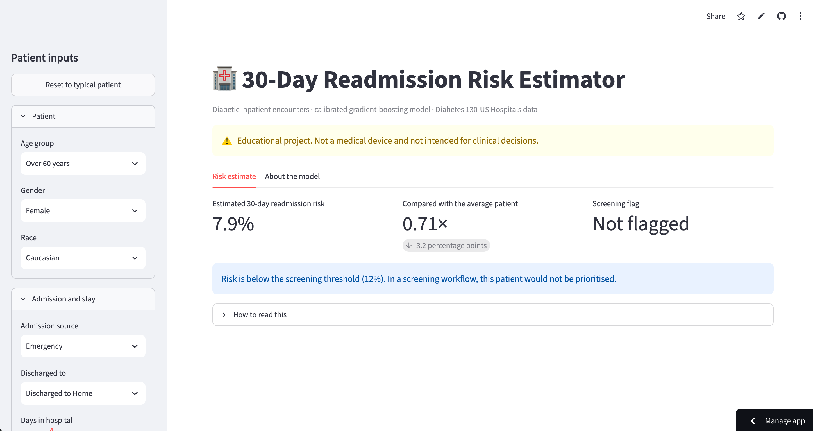

# Patient Readmission Risk Prediction

Predicting 30-day hospital readmission for diabetic patients, with a calibrated risk score served through a Streamlit app.

**Live demo:** [patient-readmission-prediction-wachirapat.streamlit.app](https://patient-readmission-prediction-wachirapat.streamlit.app)

<!-- Add an app screenshot here:  -->

> Educational project. Not a medical device and not intended for clinical use.

## Problem

About 11% of diabetic patient encounters in this dataset are readmitted within 30 days. Flagging likely readmissions at discharge can help hospitals prioritise follow-up care. The model outputs a **probability**, not just a yes/no label, so the score can be read as a risk.

## Data

- [Diabetes 130-US Hospitals (1999-2008)](https://www.openml.org/d/43874), OpenML version: about 101.8K encounters.
- Target: readmitted within 30 days (positive rate about 11%).
- Alternative encodings of the target (`readmitted`, `readmit_binary`) are dropped as leakage.

## Approach

1. **Split first.** Stratified 80/20 train/test; a further 80/20 split inside train gives a fit set and a validation set.
2. **Clean** hidden missing values (`?`, `Unknown`, ...), encode binary flags, and treat "not tested" lab results as their own category.
3. **Engineer features inside a scikit-learn `Pipeline`** (`features.py`), so everything learned from data (clipping cap, scaler, encoders) comes from training data only: clipped length of stay, log medications, stay × medications interaction, total procedures, care intensity, and the three prior-visit flags kept separate.
4. **Compare models** with 5-fold CV on the training set.
5. **Test the imbalance strategy fairly:** the same Random Forest with no handling, class weights, or SMOTE.
6. **Fit a gradient-boosting model with isotonic calibration**, then choose the decision threshold on the validation set (highest threshold that still catches about 60% of readmissions).
7. **Evaluate once on the test set**, with bootstrap confidence intervals and a reliability plot.
8. **Save a single artifact** (pipeline + threshold + defaults + metrics) that the app loads, so the app cannot drift from the notebook.

## Results

**Model comparison** (5-fold CV on train, ROC-AUC / PR-AUC):

| Model | ROC-AUC | PR-AUC |
|-------|---------|--------|
| Logistic Regression | 0.634 ± 0.003 | 0.164 ± 0.001 |
| Random Forest | 0.640 ± 0.005 | 0.173 ± 0.002 |
| HistGradientBoosting | 0.637 ± 0.004 | 0.171 ± 0.002 |

The three models are within about 0.006 ROC-AUC of each other, so the final choice (HistGradientBoosting) rests on secondary grounds: fast, little tuning, and compatible with calibration.

**Imbalance experiment** (same Random Forest, same folds):

| Strategy | ROC-AUC | PR-AUC |
|----------|---------|--------|
| No imbalance handling | 0.639 ± 0.005 | 0.174 ± 0.004 |
| `class_weight` | 0.640 ± 0.005 | 0.173 ± 0.002 |
| SMOTE | 0.627 ± 0.003 | 0.165 ± 0.002 |

SMOTE lowered both scores; the final model uses no resampling and no class weights, which also keeps probabilities realistic before calibration.

**Final model on the held-out test set** (threshold 0.12, chosen on validation):

- ROC-AUC about 0.65 (95% CI 0.64-0.66), PR-AUC about 0.18 (base rate 0.11)
- Recall about 0.61 at precision about 0.165 (roughly 1.5× the base rate)
- About 41% of patients are flagged at this threshold
- Mean predicted probability matches the observed rate (0.112), and the reliability curve follows the diagonal (`assets/calibration.png`)

The exact values are in `assets/metrics.json`.

**What the model relies on** (permutation importance, drop in ROC-AUC): a prior inpatient stay is by far the strongest input, followed by non-home discharge disposition; every other input contributes less (`assets/feature_importance.png`).

## Limitations

- Moderate discriminative power (ROC-AUC about 0.65), consistent with how hard this problem is; the model suits screening and prioritisation, not individual decisions.
- About 41% of patients are flagged at the chosen threshold, and precision is only about 1.5× the base rate.
- This dataset version has no patient ID, so splits could not be grouped by patient; scores may be slightly optimistic.
- Discharge disposition is pre-grouped into "Home" and "Other", so expired and hospice encounters (excluded in the original study) cannot be removed.
- US hospitals, 1999-2008; practice patterns have changed.

## Repository

```
├── app.py                          # Streamlit app
├── features.py                     # shared cleaning + feature engineering (used by notebook and app)
├── readmission_prediction.ipynb    # full analysis and training
├── models/readmission_model.joblib # saved pipeline, threshold, defaults, metrics
├── assets/                         # calibration plot, feature importance, metrics.json
├── requirements.txt                # app dependencies (scikit-learn pinned to the training version)
└── requirements-dev.txt            # adds notebook dependencies
```

## Run locally

```bash
pip install -r requirements.txt
streamlit run app.py
```

## Retrain

```bash
pip install -r requirements-dev.txt
jupyter notebook readmission_prediction.ipynb   # run all cells; writes models/ and assets/
```

Keep `scikit-learn` in `requirements.txt` at the version printed by the last notebook cell; a model saved with one version may not load under another.

## Tech stack

Python, pandas, scikit-learn, imbalanced-learn, Streamlit
